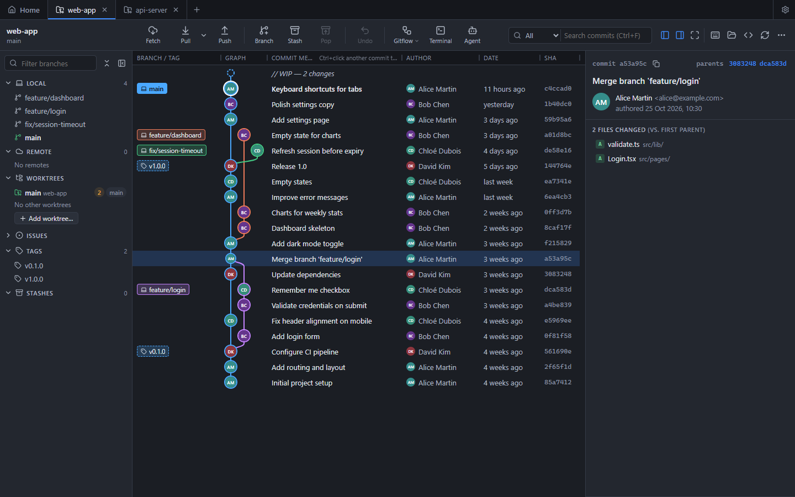
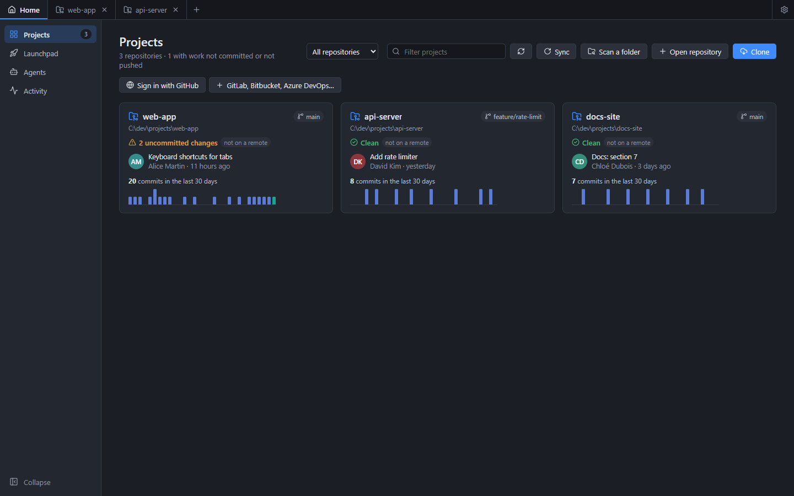
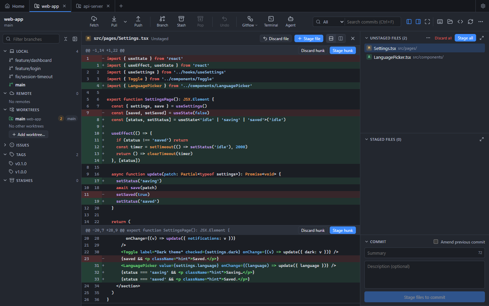
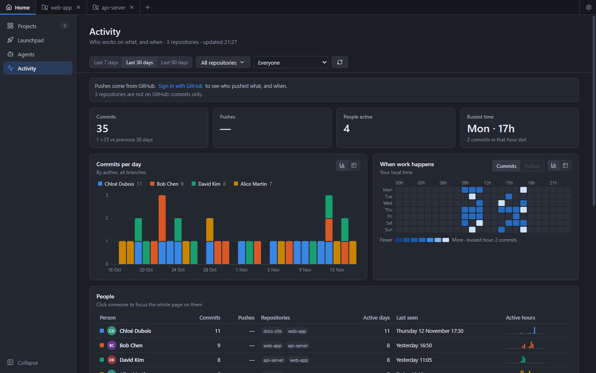
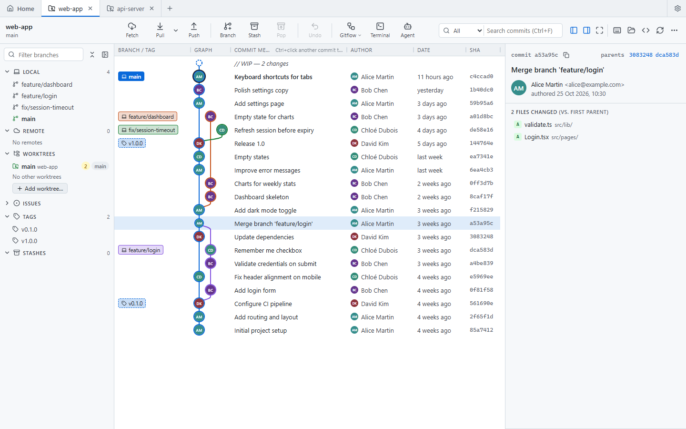

# GitDesk

A free, open-source desktop Git client.

A dashboard of all your projects, a commit graph, diffs with line-by-line staging, conflict resolution, interactive rebase, undo, a built-in terminal, worktrees and coding-agent sessions, AI help with your own API key, pull requests and issues for GitHub, GitLab, Bitbucket and Azure DevOps, and an activity dashboard. For Windows, macOS and Linux, on top of the `git` you already have installed.

[](https://github.com/TheliosGroupe/GitDesk/actions/workflows/ci.yml)
[](https://github.com/TheliosGroupe/GitDesk/releases/latest)
[](LICENSE)



| Projects                                                   | Diff                                         | Activity                                                  |
| ---------------------------------------------------------- | -------------------------------------------- | --------------------------------------------------------- |
|  |  |  |

Light theme too: 

## Quick start

1. Install [git](https://git-scm.com/downloads) 2.30 or later if you do not have it yet.
2. Download GitDesk for your system from the [latest release](https://github.com/TheliosGroupe/GitDesk/releases/latest): see [Which file do I download?](#which-file-do-i-download)
3. Install and open it. The builds are not code-signed yet, so the first launch shows a warning: [here is how to get past it](#first-launch).
4. Add your repositories from the Projects page: **Scan a folder** adds every repository below a folder at once, **Open repository** adds one, **Clone** downloads one.
5. Optional: sign in to GitHub, GitLab, Bitbucket or Azure DevOps ([Accounts](#accounts)) for pull requests, issues and cloning your private repositories. In a team, ask for the shared [Client ID](#team-setup) first.

## Install

### Which file do I download?

Each [release](https://github.com/TheliosGroupe/GitDesk/releases/latest) lists these files (`<version>` is the release number, for example `1.0.0`):

| Your computer                            | Download                      | Then                                                                  |
| ---------------------------------------- | ----------------------------- | --------------------------------------------------------------------- |
| Windows 10 or 11 (64-bit)                | `gitdesk-<version>-setup.exe` | Run it. It installs for your user only, without administrator rights. |
| Mac with Apple silicon (M1, M2, M3, M4…) | `gitdesk-<version>-arm64.dmg` | Open it and drag GitDesk to Applications.                             |
| Mac with an Intel processor              | `gitdesk-<version>-x64.dmg`   | Open it and drag GitDesk to Applications.                             |
| Debian, Ubuntu and derivatives (x64)     | `gitdesk_<version>_amd64.deb` | `sudo apt install ./gitdesk_<version>_amd64.deb`                      |
| Any other Linux distribution (x64)       | `gitdesk-<version>.AppImage`  | `chmod +x gitdesk-<version>.AppImage`, then run it.                   |

Not sure which Mac you have? Apple menu → **About This Mac**: "Chip: Apple M…" is Apple silicon, "Processor: Intel…" is Intel.

You can ignore the other files: `latest.yml`, `latest-mac.yml`, `latest-linux.yml` and the `.blockmap` files are read by GitDesk's update checks, `gitdesk-<version>-mac-<arch>.zip` is the same Mac app packed for the updater (take the `.dmg`), and `SHA256SUMS.txt` lists the checksum of every file, to [check a download](#check-a-download).

There are no builds for Windows on ARM or Linux on ARM yet.

### First launch

The builds are not code-signed yet, so your system warns you the first time you open GitDesk. Only do this with files downloaded from this repository's [Releases](https://github.com/TheliosGroupe/GitDesk/releases).

- **Windows**: SmartScreen shows "Windows protected your PC". Click **More info**, then **Run anyway**. (Your browser may also say the file is not commonly downloaded: choose **Keep**.)
- **macOS 15 (Sequoia) and later**: open GitDesk once; macOS says it cannot check it: click **Done**. Then open **System Settings → Privacy & Security**, scroll down to the message about GitDesk and click **Open Anyway**, then confirm with your password. GitDesk opens normally from then on.
- **macOS 14 and earlier**: in Applications, Control-click (or right-click) GitDesk → **Open**, then **Open** again.
- **macOS, if it says GitDesk "is damaged"** or **Open Anyway** does not appear: remove the quarantine flag the browser put on the download, then open GitDesk again:

  ```sh
  xattr -dr com.apple.quarantine /Applications/GitDesk.app
  ```

- **Linux AppImage**: it needs FUSE 2 (`sudo apt install libfuse2`; `libfuse2t64` on Ubuntu 24.04 and later). If it stops with a sandbox error on a recent Ubuntu, install the `.deb` instead.

On first launch GitDesk checks that it can run `git`, and tells you what to do if it cannot.

### Check a download

Compare the file's SHA-256 with the line for it in `SHA256SUMS.txt` (`Get-FileHash <file>` in PowerShell, `shasum -a 256 <file>` on macOS, `sha256sum <file>` on Linux). Each release also carries a build-provenance attestation: with the [GitHub CLI](https://cli.github.com/), `gh attestation verify <file> --repo TheliosGroupe/GitDesk` checks that the file was built by this repository's release workflow.

### Requirements

- **git 2.30 or later**, on your `PATH`. GitDesk runs the first `git` it finds there, by its full path; set the `GITDESK_GIT` environment variable to the full path of another one. Windows: [Git for Windows](https://git-scm.com/download/win). macOS: `xcode-select --install` (Apple's git) or `brew install git`. Linux: your distribution's `git` package. A few things work better with a newer git: the check that tells whether merging another branch would really conflict needs git 2.38, and some protections for repositories you did not create need git 2.44 (see [Security](#security)).
- Optional: an account on the services you use, an AI provider's API key, and the coding-agent CLIs you want to run (they are not included).

### Updates

GitDesk looks for new releases in the background, shortly after it starts and then every 6 hours (**Settings → Updates** turns this off). On Windows and Linux it downloads a new version and installs it when you click **Restart to install**: nothing installs without you. macOS builds are not signed yet, so macOS cannot install an update by itself: GitDesk tells you a new version is available and opens its download page; download the new `.dmg` and replace the app in Applications (your settings are kept).

**Settings → Updates** also shows the version you are running, **Copy diagnostics** (the versions of GitDesk, your system and git, for a bug report: no folder, repository or account name) and **Third-party licenses** (the licenses of the open-source components GitDesk ships with).

## Features

### Home and tabs

Each repository opens in its own tab. **Home**, pinned at the left of the tab bar, holds the Projects, Launchpad, Agents and Activity pages behind a small navigation (collapse it to icons for more room); it reopens on the page you used last. Drag tabs to reorder them (or `Ctrl+Shift+PageUp` / `PageDown`); the order is kept between launches. The **+** after the last tab opens or clones a repository.

### Projects dashboard

- One card per repository: current branch, uncommitted changes, commits to push/pull, last commit and a 30-day activity chart. Most recently active projects first.
- **Sync** fetches every repository that has a remote; right-click a card to fetch just one, open it in your editor or file manager, or remove it.
- **Scan a folder** adds every repository below a folder at once. **Clone** lists your repositories on every connected service, private ones included.
- **Workspaces** group repositories (for example _Work_ and _Personal_): filter the dashboard, sync a whole workspace, or clone every repository of an organization into one.

### Repository view

- **Commit graph** of all branches with branch/tag labels, author pictures, the checked-out commit ringed, and a `// WIP` row for uncommitted work. Double-click a branch label to check it out.
- **Search** commits by message, author or SHA (`Ctrl+F`); matching rows stand out in the graph.
- **Sidebar**: local branches (↑ ahead / ↓ behind), remote branches, worktrees, tags, stashes, the repository's open **pull / merge requests** (check one out as `pr/<number>` in one click) and **issues** (create a branch from one).
- **Diffs**, unified or split, with **syntax highlighting**. Stage, unstage or discard a whole file, a hunk, or **just the lines you select** (click or drag in the line-number gutter).
- **Commit** with summary + description, or amend the previous commit.
- **Conflict resolution**: open a conflicted file and pick _current_, _incoming_ or _both_ for each conflict, then _Mark resolved_. A banner offers Continue / Abort for merges, rebases, cherry-picks and reverts. Binary files, files that are not UTF-8 and files over 5 MB are resolved by taking a whole side (or in your editor).
- **Hidden characters**: bidirectional controls and invisible characters (the _Trojan Source_ trick) in diffs, blame, line history, conflicts, file and branch names show as markers such as `U+202E`, with a warning above the code. A file's leading byte order mark shows as a quiet `BOM` marker, without the warning.
- **Big changes stay responsive**: long diffs and long file lists only draw what is on screen, so a 60,000-line diff or 5,000 new files open at once and can still be staged line by line.
- **Undo** the last action (commit, amend, checkout, merge, rebase, reset, branch and tag changes…) with the toolbar button or `Ctrl+Z`. GitDesk refuses when the repository changed since, so it never undoes the wrong thing.
- **Branches**: create, rename, delete, merge, rebase onto, push, delete on the remote, **create a pull request** (GitHub, GitLab, Bitbucket, Azure DevOps). **Drag a branch onto the current branch** to merge or rebase.
- **Compare** any two branches, tags or commits (right-click → _Compare with…_, or `Ctrl+click` a second commit): commits on each side and the changed files.
- **Gitflow**: initialize, start and finish features, bugfixes, releases and hotfixes (compatible with git-flow's settings), with undo.
- **Conflict warnings**: GitDesk tells you when another branch changes the same files as your work, and whether merging it would really conflict.
- **Patches**: export a commit or your changes as a `.patch` file, apply one (`git am` / `git apply`).
- **Interactive rebase**: reorder (drag or Alt+↑/↓), reword, squash, fixup or drop commits, all from a dialog.
- **Commits**: right-click to create a branch or tag, check out, cherry-pick, revert, reset (soft / mixed / hard), or rebase.
- **Tags**: create, push to the remote, delete locally and on the remote.
- **Stash** with a message, apply, pop, delete; double-click a stash to apply it.
- **Files**: right-click for file history and blame (select lines in the blame for their **line history**), open in your editor, show in Explorer/Finder, copy the path, or add to `.gitignore`.
- **Toolbar**: sync (fetch + refresh), fetch, pull (fast-forward / merge / rebase), push (sets the upstream on first push, force-with-lease from the pull menu).
- **Built-in terminal** (`` Ctrl+` ``) at the bottom of each repository, opened in its folder: the graph follows what you do in it live.
- **Worktrees**: create, open in their own tab, remove.
- **Layout**: resize the panels; collapse the sidebar to an icon rail (`Ctrl+Shift+B`) and the details panel (`Ctrl+Shift+J`), or hide both with **focus mode** (`Ctrl+Shift+F`). Graph columns can be resized (drag a header border, double-click it to fit the content) and hidden (right-click the header). Working-copy sections collapse, resize and maximize; the terminal maximizes over the graph. The layout is kept between launches.
- **Branch colors** (Settings → Appearance): edit the eight lane colors of each theme or pick a preset (Default, Vivid, Pastel, Colorblind-safe), and give branches matching a pattern (`main`, `feature/*`…) their own color on their lane, label and sidebar icon.
- Refreshes automatically when files or refs change (also those of a linked worktree, and not for files git ignores, such as build output) and when the window regains focus.

### Coding agents

The **Agents** page of Home gives a task to a coding agent — Claude Code, Codex, Gemini CLI, Copilot CLI, OpenCode or your own command — that works in its own worktree and branch, in a terminal you can watch. Open its worktree to review the commits, merge them by dragging the branch, then end the session to remove the worktree. The agent CLIs are not included: install the ones you use. Commands can be changed in Settings → Terminal & agents.

### AI (bring your own key)

Optional, with an Anthropic or OpenAI API key, or a local model through Ollama or any OpenAI-compatible server:

- Write the **commit message** from your changes, following the repository's style.
- Write a **pull request** title and description.
- **Explain** a commit or a branch.
- **Suggest a resolution** for each conflict (you still review and confirm it).
- **Compose commits**: split your changes into several logical commits, down to single hunks, then edit the plan before committing.

Your code is sent to the provider you choose only when you click one of these buttons. Keys are encrypted like account tokens.

- A key is sent only to the base URL it was saved for: changing the URL asks for the key again. Anthropic and OpenAI need `https://`, except for a server on this computer. (Keys saved by earlier versions are tied to the provider's default URL: with a custom OpenAI-compatible or local server, enter the key once more.)
- Files that look like secrets (`.env` and `*.env`, `.envrc`, private keys, `*.tfvars`, `terraform.tfstate`, kubeconfig, `.docker/config.json`, credential files, or content shaped like a token) are never sent, only their names, and GitDesk lists them. In Compose, one secret-looking hunk withholds the whole file.
- Conflict suggestions are never used by themselves: you accept them conflict by conflict.
- Compose refuses more than 300 changes or more than 8 MB of diff, rather than leaving some out.

### Launchpad

The **Launchpad** page of Home gathers, across every connected account: pull requests waiting for your review, your own pull requests with their CI and review status, and the issues assigned to you (GitHub, GitLab, Jira, Linear). Open, check out or clone from there.

### Activity dashboard

The **Activity** page of Home shows who works on what, and when, across every repository:

- **Period** (last 7 / 30 / 90 days), **repositories** and **person** filters scope the whole page.
- **Commits**, **pushes**, **people active** and **busiest time**, compared with the previous period.
- **Commits per day** stacked by person, a **weekday × hour heatmap**, a **people** table, and a feed of every push, force push, PR merge and branch creation/deletion (expand a push to see its commits).

Commits come from your local clones (all branches, remote ones included). Pushes come from GitHub's _Repository activity_ API (up to 3 months back), so they need a signed-in account that can read the repository. Every chart has a table view and can be read with the keyboard.

### Settings

Dark, light or system theme · branch colors · editor used by "Open in editor" (VS Code, Cursor or the system default app) · accounts and issue trackers · AI provider · terminal shell, worktree folder and agent commands · background fetch interval · author pictures (GitHub, Gravatar) · clone folder · automatic updates, the version you run, **Copy diagnostics** and **Third-party licenses**.

### Keyboard shortcuts

Press `?` in a repository for the full list. On macOS, use `⌘` instead of `Ctrl`.

| Shortcut                         | Action                                      |
| -------------------------------- | ------------------------------------------- |
| `F5`                             | Sync (fetch all remotes and refresh)        |
| `Ctrl+F`                         | Search commits                              |
| `Ctrl+Z`                         | Undo the last action                        |
| `Ctrl+Enter`                     | Commit                                      |
| `Ctrl+Shift+P` / `Ctrl+Shift+L`  | Push / pull                                 |
| `Ctrl+B`                         | New branch                                  |
| `Ctrl+Shift+S`                   | Stash                                       |
| `Ctrl+Shift+A`                   | Stage all                                   |
| `` Ctrl+` ``                     | Show or hide the terminal                   |
| `Ctrl+Shift+B` / `Ctrl+Shift+J`  | Collapse the sidebar / the details panel    |
| `Ctrl+Shift+F`                   | Focus mode (hide both side panels)          |
| `Ctrl+1` / `Ctrl+2…9`            | Home / repository tabs, in order            |
| `Ctrl+Shift+1…4`                 | Home: Projects, Launchpad, Agents, Activity |
| `Ctrl+Shift+PageUp` / `PageDown` | Move the repository tab left / right        |
| `Ctrl+Tab`, `Ctrl+W`, `Ctrl+,`   | Next tab, close tab, settings               |
| `↑` / `↓`, `Esc`                 | Move in the graph, close a diff             |

## Accounts

### GitHub

GitDesk signs in with GitHub's _device flow_ through an OAuth App's **Client ID**, so no secret ships with the app. In a team, one shared OAuth App is enough: see [Team setup](#team-setup). On your own, create one in 2 minutes:

1. Open https://github.com/settings/applications/new (Settings → Developer settings → **OAuth Apps** → New OAuth App). Not _GitHub Apps_: that form asks for a webhook URL and gives tokens that expire, which GitDesk does not handle.
2. Name `GitDesk`; Homepage URL and Authorization callback URL `http://localhost`.
3. Tick **Enable Device Flow**, **untick Expire user access tokens** (expiring tokens last 8 hours and renewing them needs the client secret, which GitDesk deliberately does not have), then **Register application**.
4. Copy the **Client ID** into GitDesk (sign-in dialog, or Settings → Accounts & integrations). Do not generate a client secret: GitDesk never needs one.

Then **Sign in with GitHub** on the Projects page: GitDesk shows a code, opens github.com/login/device, you approve. Several accounts are supported.

- **Clone from GitHub**: pick from your repositories or paste a link (`https://github.com/owner/repo`, `git@github.com:owner/repo.git` or `owner/repo`). Clones are partial (`--filter=blob:none`): history comes at once, file contents when needed.
- **Followed repositories** (cloned through GitDesk with a GitHub account) are fetched in the background every 5 minutes (configurable). Your working files are never changed by this.
- **Profile pictures**: GitHub avatars (via your account, or anonymously for public repositories), then Gravatar (can be turned off), then initials.

### GitLab, Bitbucket, Azure DevOps, GitHub Enterprise

Settings → Accounts & integrations → **Add account**, then paste a personal access token (the dialog lists the scopes it needs and links to the page that creates it). Self-managed GitLab and GitHub Enterprise Server hosts are supported.

### Jira and Linear

Settings → Accounts & integrations: your Jira Cloud site, email and API token, or a Linear API key. Their issues assigned to you appear in the Launchpad and the repository sidebar.

### Team setup

For a team, one person creates **one OAuth App for everyone**, and each teammate signs in with their own GitHub account:

1. Create the OAuth App as in [GitHub](#github) above, with **Enable Device Flow** ticked and **Expire user access tokens** unticked. If your team has a GitHub organization, create it there (organization **Settings → Developer settings → OAuth Apps**), so it does not depend on one person's account.
2. Share its **Client ID** with the team (chat, wiki, onboarding notes). It is not a secret: it identifies the app, and it is shown on GitHub's sign-in page anyway. There is no client secret to share.
3. Each teammate pastes it in **Settings → Accounts & integrations → GitHub OAuth App Client ID**, then clicks **Sign in with GitHub**. Each person's token stays encrypted on their own computer.
4. If the organization restricts OAuth App access, an organization owner approves the app once: a member requests it from their GitHub **Settings → Applications → Authorized OAuth Apps → GitDesk**, and the owner approves it in the organization's **Settings → Third-party access → OAuth app policy**. Until then, the organization's private repositories do not appear in GitDesk.

GitLab, Bitbucket and Azure DevOps have no shared app: each person creates their own personal access token.

## Your data

### Where GitDesk keeps it

Everything GitDesk stores is in one folder per user:

| System  | Folder                                  |
| ------- | --------------------------------------- |
| Windows | `%APPDATA%\gitdesk`                     |
| macOS   | `~/Library/Application Support/gitdesk` |
| Linux   | `~/.config/gitdesk`                     |

- `gitdesk.json`: your repository list, workspaces, open tabs, layout, settings and which repositories you trusted.
- `accounts.json`, `integrations.json`, `ai-keys.json`: your hosting accounts, Jira and Linear, and AI providers. Tokens and keys in them are encrypted with the operating system's key store (DPAPI on Windows, Keychain on macOS, the system keyring on Linux).
- `avatars.json`: a cache of author pictures. `issue-links.json`: which branch was created from which issue. `agent-tasks/`, `no-hooks/`: working files of coding-agent sessions and of repository trust.
- The rest (`Cache`, `GPUCache`, `Local Storage`…) is the browser cache of the window.

Downloaded updates wait in `%LOCALAPPDATA%\gitdesk-updater` (Windows) or `~/.cache/gitdesk-updater` (Linux). Your repositories stay where they are: removing one from GitDesk only takes it off the list, and new clones go to the clone folder of Settings → General (`repos` in your home folder by default).

### Reset

Quit GitDesk, then delete (or rename) that folder: GitDesk starts again as on the first launch. To start over with only the repository list and settings, delete `gitdesk.json` alone. If a settings file is damaged, GitDesk keeps it as `<name>.corrupt-<time>` and tells you.

### Uninstall completely

- **Windows**: Settings → Apps → Installed apps → GitDesk → **Uninstall**. The uninstaller keeps your data: then delete `%APPDATA%\gitdesk` and `%LOCALAPPDATA%\gitdesk-updater`.
- **macOS**: quit GitDesk, move `GitDesk.app` from Applications to the Trash, then delete `~/Library/Application Support/gitdesk`. Keychain Access may also hold a `gitdesk Safe Storage` entry (the key that encrypted your tokens): you can delete it too.
- **Linux**: `sudo apt remove gitdesk` for the `.deb`, or delete the AppImage; then delete `~/.config/gitdesk` and `~/.cache/gitdesk-updater`.

Then revoke what GitDesk was given, if you no longer need it: on GitHub, Settings → Applications → **Authorized OAuth Apps** → GitDesk → Revoke; the personal access tokens and API keys on each service.

### What GitDesk connects to

GitDesk has no telemetry, analytics or crash reporting. It connects to:

| What             | Where                                                                                                                           | When                                                                                                                                           |
| ---------------- | ------------------------------------------------------------------------------------------------------------------------------- | ---------------------------------------------------------------------------------------------------------------------------------------------- |
| git              | your repositories' remotes                                                                                                      | when you clone, fetch, pull, push or click **Sync**, and in the background for repositories you cloned with a GitHub account (every 5 min)     |
| Hosting services | GitHub, GitLab, Bitbucket, Azure DevOps, your GitHub Enterprise or GitLab server                                                | only for accounts you signed in to: repository lists, pull requests, issues, CI status, Launchpad, Activity                                    |
| Issue trackers   | your Jira Cloud site, Linear                                                                                                    | only once you connected them                                                                                                                   |
| Author pictures  | GitHub (anonymously for public repositories on github.com, or with your account); gravatar.com with a SHA-256 hash of the email | when commits are shown and author pictures are on (Settings → Appearance turns pictures, or only Gravatar, off). Cached, misses retried weekly |
| Updates          | this repository's GitHub Releases                                                                                               | shortly after start, then every 6 hours, unless turned off in Settings → Updates; also when you click **Check now** there                      |
| AI providers     | the provider and address you set (Anthropic, OpenAI, Ollama or another server)                                                  | only when you click an AI button, and only once one is configured                                                                              |
| Your browser     | the link you clicked                                                                                                            | links and sign-in pages open in your browser, not in GitDesk                                                                                   |

What you run yourself (commands in the built-in terminal, coding agents) connects to whatever it connects to.

## Security

GitDesk opens repositories you may not have written, talks to hosting services with your tokens and can send code to an AI provider you chose. This section says what it does to keep that safe; [SECURITY.md](SECURITY.md) has the security model in short and how to report a vulnerability.

### Repositories you did not create

A repository's own settings can run programs (hooks, `core.fsmonitor`, diff and merge drivers, filters, credential helpers, `core.sshCommand`…) or send git elsewhere (proxies, `insteadOf`, a remote's own server programs). GitDesk trusts the repositories it cloned or created. Any other repository is inspected before git runs there, by reading its files (its settings and the files they include, hooks, submodules and nested repositories, `.git` files, `commondir`, `alternates`, worktree lists), without running git. Until you trust it:

- the settings that would run a program are replaced on every git command by your own (system and global) value or a harmless one, and a banner in the repository lists them (**Trust this repository…** turns them back on; new risky settings ask again);
- when its settings change how git connects, fetch, pull and push are refused, Git LFS files are not downloaded and no credentials are given (GitDesk's account token included). `GIT_NO_LAZY_FETCH` (git 2.44 or later) also stops a partial clone from downloading missing files on demand; older git ignores it, and network commands are still refused;
- when its settings point to files on another computer (a network path in a `.git` file, `alternates`, an include, a worktree, or a folder link), or to a file GitDesk cannot fully check (over 1 MiB, not a regular file, more than 100 submodules), git does not run there at all. A partial clone whose remote is on another computer is blocked too.

Whatever the trust, diffs, logs and blame never run textconv or external diff programs, and a repository's `core.worktree` cannot move the working copy GitDesk writes to out of the folder you added.

What stays off until you trust a repository (your own system and global git settings still apply):

| Kind                   | Repository settings                                                                                                                                                                                                                                                                                                                                                                       | Until you trust it                                                      |
| ---------------------- | ----------------------------------------------------------------------------------------------------------------------------------------------------------------------------------------------------------------------------------------------------------------------------------------------------------------------------------------------------------------------------------------- | ----------------------------------------------------------------------- |
| Programs git would run | hooks (`.git/hooks`, `core.hooksPath`; Git LFS's own hooks are allowed), `core.fsmonitor`, `core.sshCommand`, `core.askPass`, `core.gitProxy`, `core.alternateRefsCommand`, `credential.helper`, `diff.external`, `diff.<driver>.textconv` / `command`, `filter.<driver>.*` (except Git LFS's), `merge.<driver>.driver`, `gpg.program`, `sequence.editor`, `submodule.<name>.update = !…` | replaced by your own value or a harmless one                            |
| How git connects       | `http.proxy`, `remote.<name>.proxy`, TLS settings (`http.sslVerify=false`, CA and client certificates), `http.extraHeader`, cookie files, `url.<base>.insteadOf`, `remote.<name>.uploadpack` / `receivepack`, `protocol.allow`                                                                                                                                                            | fetch, pull and push refused, no credentials given                      |
| Where git reads from   | a network path in a `.git` file, `commondir`, `alternates`, an include or a worktree; a settings file over 1 MiB or more than 100 submodules                                                                                                                                                                                                                                              | git does not run in the repository                                      |
| Where GitDesk writes   | `core.worktree` or a `.git` file moving the working copy elsewhere                                                                                                                                                                                                                                                                                                                        | ignored whatever the trust: GitDesk writes only in the folder you added |

### Hidden and bidirectional characters

A right-to-left override or an invisible character can make code, a file name or a branch name read differently from what it is (CVE-2021-42574, _Trojan Source_). GitDesk never lets one act: in code views it is drawn as a marker (`U+202E`, with the character's name as a tooltip) and a banner warns that the file contains such characters; in names, dialog titles, menus and notifications it is drawn as a marker too, and names are isolated from the sentence around them. Tabs, right-to-left letters and emoji joiners are ordinary text. A UTF-8 byte order mark at the very start of a file (Visual Studio and PowerShell write one) is shown as a quiet `BOM` marker and does not raise the warning.

### Accounts, keys and the app itself

Tokens and API keys are encrypted with the operating system's key store (Electron `safeStorage`: DPAPI on Windows, Keychain on macOS, the system keyring on Linux) and never reach the UI. For repositories cloned with an account, git gets the token through a one-shot credential helper that answers only over https and only for that account's own host, and reads it from an environment variable, so it never appears in a command line, a remote URL or a config file. Worktrees of such a repository use the same account. Commits run without the token, so commit hooks do not see it. Other repositories keep using your normal git credentials. API calls (and AI requests with your API key) never follow links or redirects outside the service's own address, and every answer is checked before it reaches the UI. Profile pictures from other addresses are only fetched over https from public hosts, connecting only to the public address that was checked (through a system proxy, the proxy decides). Every API call and picture download has a time limit and a size limit. Signing out deletes the token locally; revoke it on the service too if you no longer need it.

The UI is served from `app://gitdesk` with a strict Content Security Policy and cannot navigate anywhere else (https links open in your browser); the IPC bridge only answers GitDesk's own top-level page, web permissions other than the clipboard are denied, and the packaged app's Electron fuses are hardened (no `NODE_OPTIONS`, no inspector flags, ASAR integrity checked). Network commands stop after a period without progress (fetch and pull 10 minutes, push 30) and can be cancelled from the toolbar. A settings file GitDesk cannot read is never overwritten: a damaged one is kept as `<name>.corrupt-<time>` and GitDesk tells you where.

### Updates and builds

- GitDesk checks GitHub Releases shortly after it starts and then every 6 hours. Settings → Updates turns these automatic checks off right away, without a restart. `npm run dev` never updates itself.
- On Windows and Linux a new version downloads in the background and installs only when you click **Restart to install**. macOS cannot install unsigned updates, so GitDesk opens the release page instead.
- The builds are not code-signed yet: an update is checked against the SHA-512 listed in the same GitHub release, nothing more. To check a download yourself, see [Check a download](#check-a-download).

To report a vulnerability, see [SECURITY.md](SECURITY.md): please use a private GitHub Security Advisory, not a public issue.

## Known limitations

- **Unsigned builds**: Windows and macOS warn on [first launch](#first-launch), and an update is only checked against the SHA-512 listed in the same GitHub release. Code-signed builds are planned.
- **macOS updates are manual**: GitDesk tells you a new version is out and opens its download page.
- **Platforms**: Windows x64, macOS (Apple silicon and Intel) and Linux x64. Type checks, lint and unit tests run on all three on every change; the end-to-end tests, which drive the real app, run on Windows, so macOS and Linux have had less hands-on testing. Reports from those systems are especially welcome.
- **Linux without a keyring**: tokens and keys are encrypted through the desktop's keyring (GNOME Keyring, KWallet…). Where none runs, Electron would fall back to a built-in key that only hides them, so GitDesk refuses to save them: sign in to a desktop session with a keyring before adding an account or a key.
- **GitHub sign-in needs an OAuth App Client ID** (see [Team setup](#team-setup)): GitDesk does not ship one.
- **Push history** in the Activity page comes from GitHub only; other services show commits from your clones.
- **Not there yet**: submodules and Git LFS management, commit signing (GPG / SSH) settings, other languages than English.

## Build from source

You need Node.js 22.12 or later (`.nvmrc` names Node 22), git 2.30 or later and, on Linux, the build tools of the terminal's native module (`node-pty`): `python3`, `make` and a C++ compiler (`sudo apt install build-essential python3` on Debian and Ubuntu). Windows and macOS need nothing more: `node-pty` ships prebuilt binaries there.

```sh
git clone https://github.com/TheliosGroupe/GitDesk.git
cd GitDesk
npm ci             # also downloads the Electron binary
npm run dev        # development mode with hot reload (F12 opens DevTools)
```

To build installers: `npm run build:win`, `npm run build:mac` or `npm run build:linux` (output in `dist/`), or `npm run build:unpack` for an unpacked folder. `npm run dev` never updates itself.

> If GitDesk opens as a blank Node process from a VS Code terminal, unset `ELECTRON_RUN_AS_NODE` first (`Remove-Item Env:ELECTRON_RUN_AS_NODE` in PowerShell). Some VS Code contexts set it, which makes Electron behave like plain Node.

[CONTRIBUTING.md](CONTRIBUTING.md) explains [how GitDesk is built](CONTRIBUTING.md#how-it-is-built), how to run the checks and tests, and how releases are made.

## Report a bug or ask for a feature

Open an [issue](https://github.com/TheliosGroupe/GitDesk/issues/new/choose). For a bug, paste the text from **Settings → Updates → Copy diagnostics**: it holds the versions of GitDesk, your system and git, and no folder, repository or account name. Security problems are reported privately instead: see [SECURITY.md](SECURITY.md).

## Trademarks

Git is a trademark of Software Freedom Conservancy. GitKraken is a trademark of Axosoft. GitHub, GitLab, Bitbucket, Azure DevOps, Jira, Linear, Claude and Anthropic, OpenAI, Gravatar, Visual Studio Code, Cursor and the other product and company names mentioned here belong to their respective owners and are used only to say what GitDesk works with. GitDesk is an independent project: it is not affiliated with, sponsored by or endorsed by any of them.

## License

[MIT](LICENSE) © 2026 THELIOS CAPITAL. GitDesk ships open-source components under their own licenses: **Settings → Updates → Third-party licenses** lists them.
